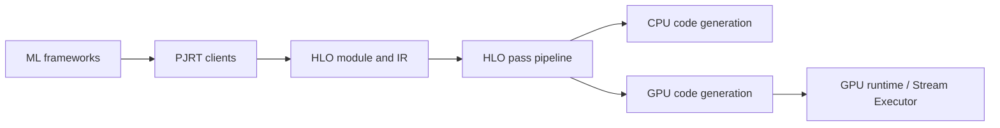

# openxla/xla

> Compilateur ML open source pour GPU, CPU et accélérateurs, utilisé via PyTorch, TensorFlow et JAX.

## Le problème
Exécuter efficacement un même modèle sur différents matériels demande un compilateur d'opérations d'algèbre linéaire.

## Ce que ça fait vraiment
Reçoit des calculs depuis des frameworks, les représente en HLO, applique des passes d'optimisation, génère du code pour CPU (moteur d'exécution) ou GPU (pipeline de thunks, autotuning) puis exécute. Interfaces clientes (local, Python, PJRT) et Stream Executor. Le README précise que seuls les contributeurs et intégrateurs doivent cloner ce dépôt.

## Comment c'est branché

## Essayer
Aucune commande documentée dans le README : utiliser la doc du framework (PyTorch, TensorFlow, JAX).

## Coût et pièges
Pas besoin de le compiler pour l'utiliser via un framework. Dépôt volumineux, 1 489 issues ouvertes.

## Ce que ce n'est pas
Pas une bibliothèque à appeler directement dans un notebook : c'est le moteur sous JAX/TF.

## Alternatives
Aucune alternative nommée dans le README.

## Pour toi
À surveiller : tu l'utilises sans y toucher via JAX ; ne l'adopte directement que pour du travail compilateur.

