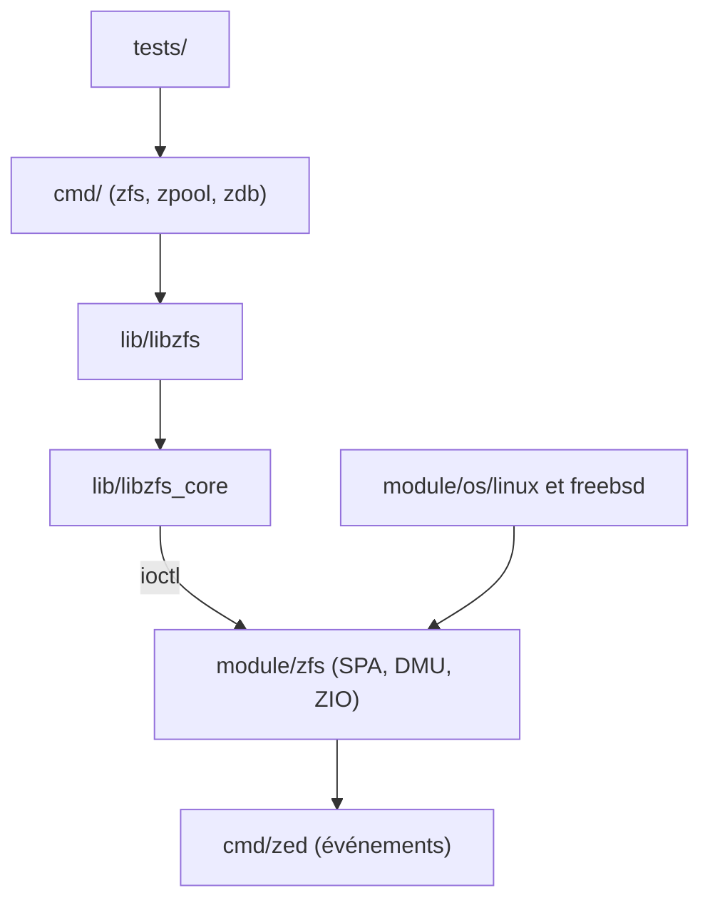

# openzfs/zfs

> Advanced file system and volume manager for Linux and FreeBSD, for storage administrators.

## The problem
Conventional file systems protect data integrity poorly and offer neither snapshots nor flexible volumes.

## What it actually does
Provides a kernel module (pool, datasets, I/O pipeline, ARC/L2ARC caches, ZIL journal, send/receive), user libraries and the `zfs`, `zpool` and `zdb` commands. A daemon (`zed`) handles kernel events. Handles encryption, compression and deduplication. Long-term kernels from 5.10 to 6.18 are supported, as well as RHEL, Ubuntu, Debian and FreeBSD.

## How it is wired

## Trying it
No command documented in the README provided: it points to the "Getting Started" page of the documentation for each system.

## Cost and gotchas
Free. CDDL license, judged "unidentified" by GitHub and reputed incompatible with the Linux kernel's GPL: check before redistributing. Kernel module to compile or to obtain through DKMS. 1,594 open issues.

## What it is not
It is not a backup tool by itself nor a database. It is not supported on every kernel: only the listed versions are.

## Alternatives
No alternative named in the README.

## For you
Worth watching: snapshots and integrity are useful for large datasets and checkpoints on a storage server, but you need to master system administration.
