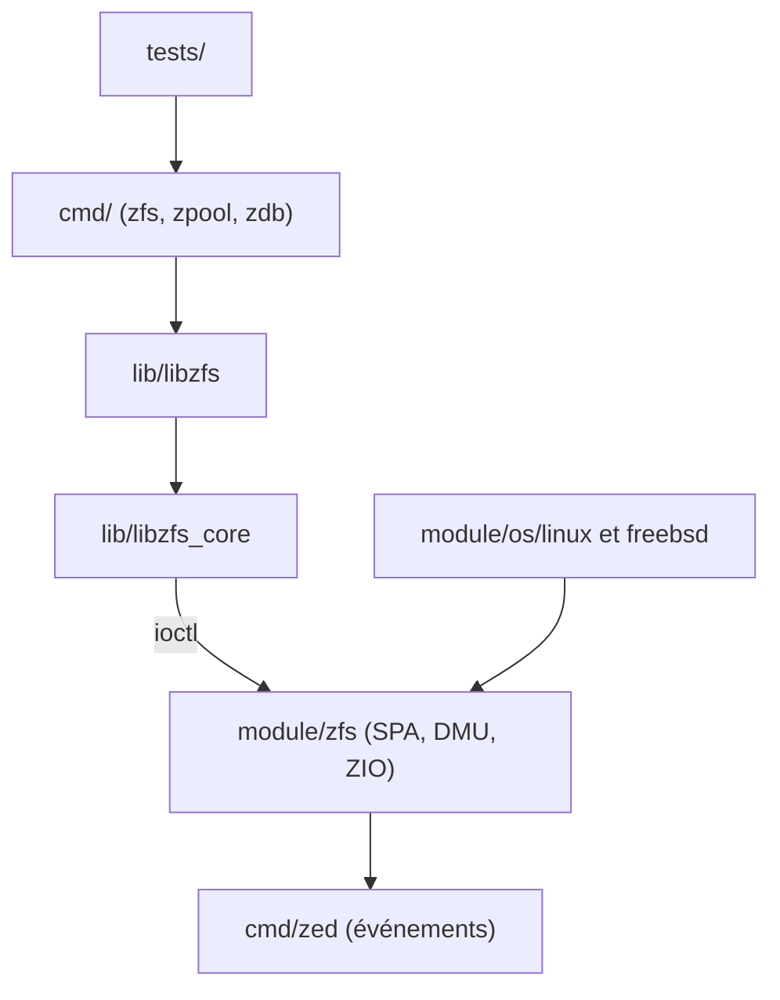

# openzfs/zfs

> Système de fichiers et gestionnaire de volumes avancé pour Linux et FreeBSD, pour administrateurs de stockage.

## Le problème
Les systèmes de fichiers classiques protègent mal l'intégrité des données et n'offrent ni instantanés ni volumes souples.

## Ce que ça fait vraiment
Fournit un module noyau (pool, jeux de données, pipeline d'E/S, caches ARC/L2ARC, journal ZIL, envoi/réception), des bibliothèques utilisateur et les commandes `zfs`, `zpool`, `zdb`. Un démon (`zed`) traite les événements du noyau. Gère chiffrement, compression et déduplication. Les noyaux longue durée de 5.10 à 6.18 sont pris en charge, ainsi que RHEL, Ubuntu, Debian et FreeBSD.

## Comment c'est branché

## Essayer
Aucune commande documentée dans le README fourni : il renvoie à la page « Getting Started » de la documentation pour chaque système.

## Coût et pièges
Gratuit. Licence CDDL, jugée « non identifiée » par GitHub et réputée incompatible avec la GPL du noyau Linux : à vérifier avant de redistribuer. Module noyau à compiler ou à obtenir par DKMS. 1 594 issues ouvertes.

## Ce que ce n'est pas
Ce n'est pas un outil de sauvegarde à lui seul ni une base de données. Il n'est pas pris en charge sur tous les noyaux : seules les versions listées le sont.

## Alternatives
Aucune alternative nommée dans le README.

## Pour toi
À surveiller : instantanés et intégrité utiles pour des datasets et checkpoints volumineux sur un serveur de stockage, mais il faut maîtriser l'administration système.

