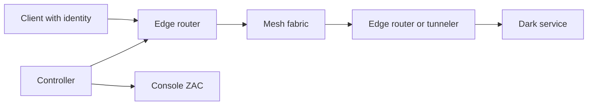

# openziti/ziti

> Zero-trust platform: controller, routers and SDKs make services invisible without an identity.

## The problem
VPNs and open ports grant too much access once you are "inside"; you need to authorize service by service.

## What it actually does
Each user, device or workload receives a cryptographic identity; connections go through an overlay mesh, encrypted end to end (mTLS, libsodium), and authorized by policy, revocable in real time. Three models: network access (router), host access (tunneler), application access (embedded SDK). REST API and web console included.

Note: the README was only read up to "Quick Start with the CLI"; the architecture from the code was not read.

## How it is wired


## Trying it
```bash
wget https://get.openziti.io/dock/all-in-one/compose.yml
docker compose up
```

## Cost and gotchas
Free and self-hostable. The README points to the documentation for production. Created and sponsored by NetFoundry. 308 open issues.

## What it is not
Not a turnkey VPN: you must define identities, services and policies. The strongest mode requires modifying application code.

## Alternatives
- zrok: simplified sharing built on OpenZiti.

## For you
Worth watching: relevant for protecting model servers or private MCPs without an open port, but setup is non-trivial.
