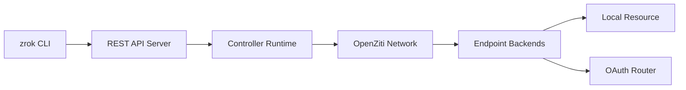

# openziti/zrok

> Sharing of web services, files and TCP/UDP ports over a zero-trust network, without touching the firewall.

## The problem
Exposing a local service or folder to someone else without opening a port or setting up a VPN.

## What it actually does
The `zrok` CLI creates public or private shares. A controller (REST API) registers the share, an agent connects through OpenZiti, and backends (public proxy, "drive" folder, TCP/UDP tunnels) serve the traffic. OAuth and usage metrics (InfluxDB) are included. A Go SDK lets you embed sharing.

## How it is wired


## Trying it
```bash
zrok invite
zrok enable
zrok share public localhost:8080
zrok share public --backend-mode drive ~/Documents
zrok share private localhost:3000
```

## Cost and gotchas
The zrok.io service is free; an account is required. Self-hosting is possible (single binary). The README talks about "enterprise reliability" without evidence.

## What it is not
Not just another ngrok: private sharing assumes the other person also uses zrok.

## Alternatives
- OpenZiti: the platform zrok is built on.

## For you
Worth watching: handy for exposing a notebook or a model demo without networking setup, keeping in mind the dependency on zrok.io if you do not self-host.
