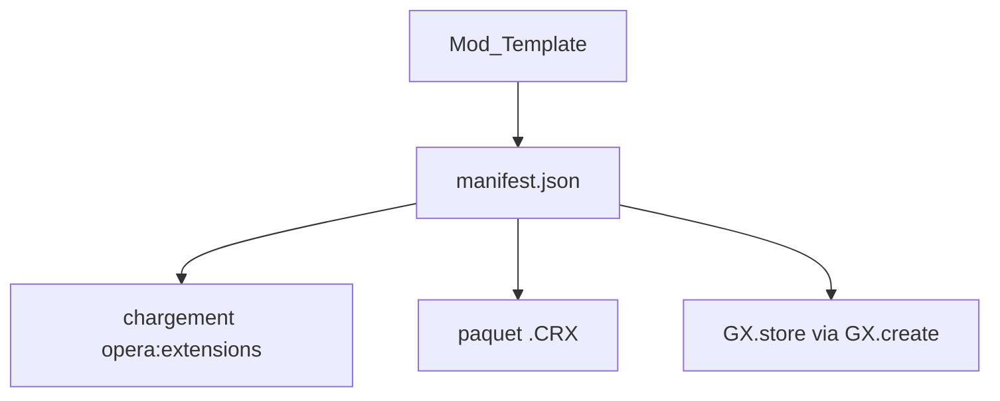

# opera-gaming/gxmods

> Documentation and examples for building Opera GX mods: themes, sounds, wallpapers, shaders.

## The problem
Customizing the Opera GX browser beyond its settings requires a mod format and a publishing path.

## What it actually does
Explains the layers of a mod: music, keyboard and browser sounds, wallpaper, theme, web page modification, shaders. Provides a template, video tutorials and the steps to load an unpacked mod or produce a .CRX. Publishing goes through GX.store via GX.create.

## How it is wired

## Trying it
Steps from the README, no shell command:
1. Open `opera:extensions`, enable developer mode.
2. Click Load unpacked and point to the folder containing manifest.json.

## Cost and gotchas
Free. An account is required to publish on GX.store. No license declared; 272 open issues.

## What it is not
Not a general web development tool: specific to Opera GX.

## Alternatives
No alternative named in the README.

## For you
Ignore: browser customization unrelated to data or AI.
