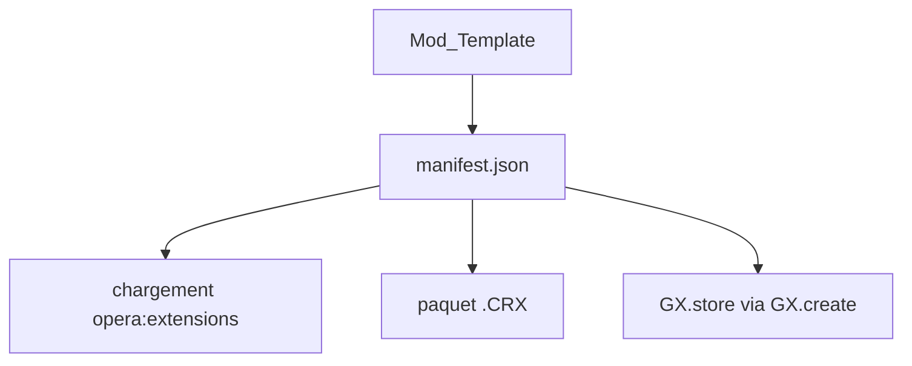

# opera-gaming/gxmods

> Documentation et exemples pour créer des mods Opera GX : thèmes, sons, fonds d'écran, shaders.

## Le problème
Personnaliser le navigateur Opera GX au-delà des réglages demande un format de mod et un circuit de publication.

## Ce que ça fait vraiment
Explique les couches d'un mod : musique, sons de clavier et du navigateur, fond d'écran, thème, modification de pages web, shaders. Donne un gabarit, des tutoriels vidéo et la marche pour charger un mod non empaqueté ou produire un .CRX. La publication passe par GX.store via GX.create.

## Comment c'est branché

## Essayer
Étapes du README, sans commande shell :
1. Ouvrir `opera:extensions`, activer le mode développeur.
2. Cliquer sur Load unpacked et pointer le dossier du manifest.json.

## Coût et pièges
Gratuit. Compte nécessaire pour publier sur GX.store. Aucune licence déclarée ; 272 issues ouvertes.

## Ce que ce n'est pas
Pas un outil de développement web général : spécifique à Opera GX.

## Alternatives
Aucune alternative nommée dans le README.

## Pour toi
À ignorer : personnalisation de navigateur sans lien avec la data ou l'IA.

