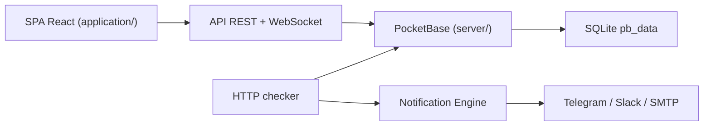

# operacle/checkcle

> Self-hosted platform for monitoring uptime, servers and certificates, for admins and DevOps.

## The problem
Knowing when a service, a domain or a certificate goes down, without subscribing to a monitoring SaaS.

## What it actually does
Monitors HTTP, DNS, ping and TCP, SSL/domain expiry, server metrics through an agent (Linux, Windows in beta). Incident history, public status pages, scheduled maintenance, email/Telegram/Discord/Slack/Matrix alerts. React/Vite front end, PocketBase backend (Go + SQLite), real time over WebSocket.

## How it is wired


## Trying it
```bash
docker run -d \
  --name checkcle \
  --restart unless-stopped \
  -p 8090:8090 \
  -v /opt/pb_data:/mnt/pb_data \
  --ulimit nofile=4096:8192 \
  operacle/checkcle:latest
```

## Cost and gotchas
Free. The default admin account (admin@example.com / Admin123456) is written in the README: change it before any exposure. 92 open issues.

## What it is not
It is not application observability (no traces or logs): it is availability monitoring.

## Alternatives
Not documented in the README.

## For you
Ignore: generic infrastructure monitoring, unrelated to tracking models or pipelines; consider it only for a homelab.
