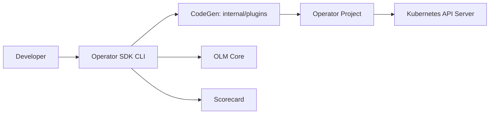

# operator-framework/operator-sdk

> SDK and CLI to scaffold, test and package Kubernetes operators (Go, Helm).

## The problem
Writing a Kubernetes operator means low-level APIs, a lot of repetitive code and little modularity.

## What it actually does
It builds on controller-runtime to offer high-level abstractions.
It generates the skeleton, the CRDs, the kustomize manifests and the OLM bundles.
Scorecard to validate an operator; e2e and integration tests.
`operator-sdk` and `helm-operator` binaries.

## How it is wired

## Trying it
No command documented in the README (it points to the website).

## Cost and gotchas
It needs a Kubernetes cluster and Go. The `gcr.io/kubebuilder/kube-rbac-proxy` images are going away: migration is mandatory.

## What it is not
Not a ready-to-use operator: it is a tool for writing them.

## Alternatives
No alternative named in the README (kubebuilder is cited as a related project, not as an alternative).

## For you
Ignore, unless you have to write an in-house operator for your ML services: it is specialized Kubernetes platform tooling.
