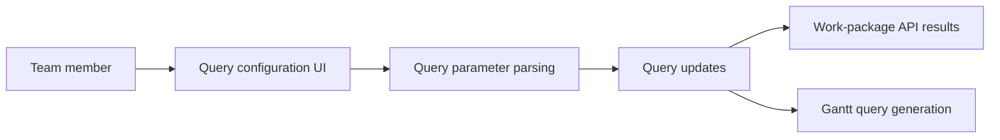

# opf/openproject

> Free, self-hostable web project management software, an alternative to Jira or MS Project.

## The problem
Planning team projects, tasks and budgets without entrusting your data to a SaaS.

## What it actually does
Project and portfolio management, agile boards (Kanban, Scrum, SAFe), Gantt, time and cost tracking, wikis, forums, meeting minutes, integrations with Nextcloud, XWiki, GitHub, GitLab. Free community edition, paid Enterprise edition (cloud or on-premises), 14-day trial.

## How it is wired

## Trying it
No command in the README; it points to the installation guides.

## Cost and gotchas
Free community edition; some features are reserved for Enterprise. Hosting is on you.

## What it is not
Not a data/AI tool. The code modules were only partially read.

## Alternatives
The README cites Jira, MS Project, Monday, Asana, YouTrack (not free software).

## For you
Ignore: generic project management, useful to a team that wants to self-host, unrelated to your field.
