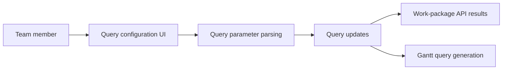

# opf/openproject

> Logiciel web libre de gestion de projet auto-hébergeable, alternative à Jira ou MS Project.

## Le problème
Planifier projets, tâches et budgets d'équipe sans confier ses données à un SaaS.

## Ce que ça fait vraiment
Gestion de projets et de portefeuilles, tableaux agiles (Kanban, Scrum, SAFe), Gantt, suivi du temps et des coûts, wikis, forums, comptes rendus de réunion, intégrations Nextcloud, XWiki, GitHub, GitLab. Édition communautaire gratuite, Enterprise payante (cloud ou sur site), essai de 14 jours.

## Comment c'est branché

## Essayer
Aucune commande dans le README ; renvoi aux guides d'installation.

## Coût et pièges
Édition communautaire gratuite ; certaines fonctions sont réservées à l'Enterprise. Hébergement à ta charge.

## Ce que ce n'est pas
Pas un outil data/IA. Les modules du code n'ont été lus que partiellement.

## Alternatives
Le README cite Jira, MS Project, Monday, Asana, YouTrack (non libres).

## Pour toi
À ignorer : gestion de projet générique, utile à une équipe qui veut s'auto-héberger, sans lien avec ton métier.

