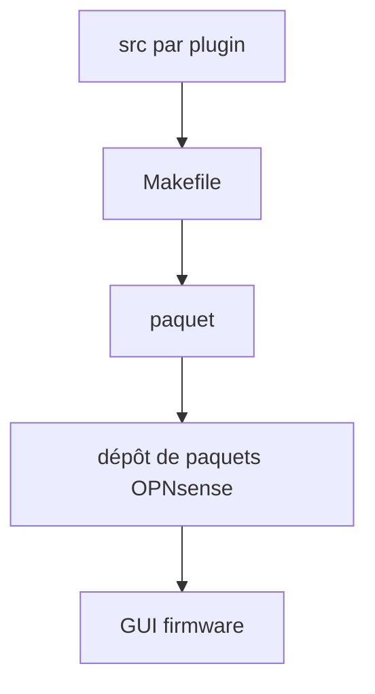

# opnsense/plugins

> Repository of optional extensions for the OPNsense firewall, for network administrators.

## The problem
Extending a firewall (VPN, proxy, monitoring, themes) without touching the core requires a common packaging framework.

## What it actually does
One directory per plugin, with a Makefile for lint, style, package, install. Plugins add services, GUI pages, authentication methods, themes. When a version of OPNsense is built, they enter the package repository. The list includes haproxy, crowdsec, tailscale, netdata, telegraf and node_exporter, among others.

## How it is wired


## Trying it
```bash
make list
make lint
cd net/haproxy
make package
```

## Cost and gotchas
Free. Some plugins are marked unmaintained; others require a subscription (ET Pro rules, Snort VRT).

## What it is not
Not a standalone installable tool: it assumes OPNsense. 259 open issues.

## Alternatives
No alternative named in the README.

## For you
Ignore on the data/AI side: this is firewall administration; only node_exporter or telegraf might interest you, and they exist elsewhere.
