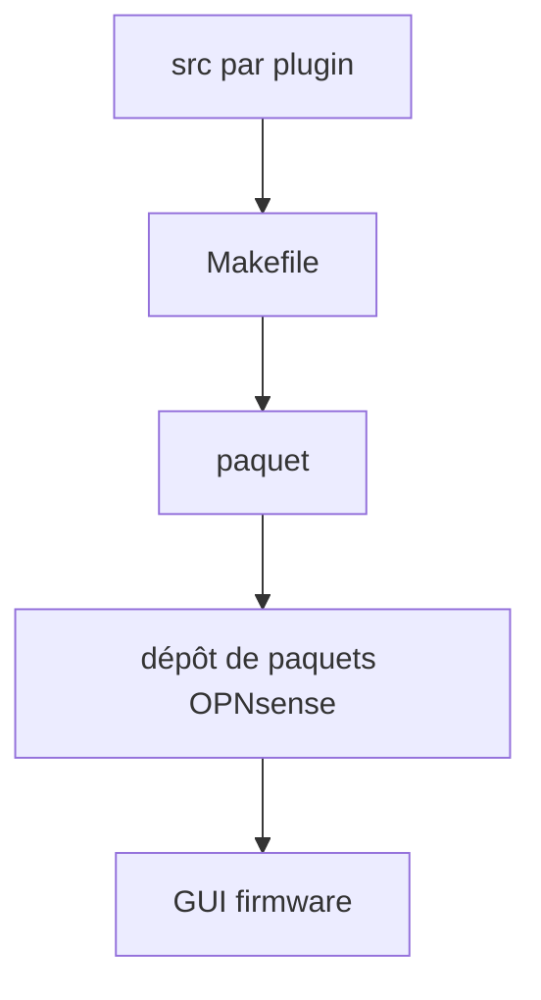

# opnsense/plugins

> Dépôt des extensions optionnelles du pare-feu OPNsense, pour administrateurs réseau.

## Le problème
Étendre un pare-feu (VPN, proxy, monitoring, thèmes) sans toucher au cœur demande un cadre commun de paquets.

## Ce que ça fait vraiment
Un répertoire par plugin, avec Makefile pour lint, style, package, install. Les plugins ajoutent des services, des pages GUI, des méthodes d'authentification, des thèmes. Au build d'une version d'OPNsense, ils entrent dans le dépôt de paquets. La liste comprend entre autres haproxy, crowdsec, tailscale, netdata, telegraf et node_exporter.

## Comment c'est branché


## Essayer
```bash
make list
make lint
cd net/haproxy
make package
```

## Coût et pièges
Gratuit. Certains plugins sont marqués non maintenus ; d'autres exigent un abonnement (règles ET Pro, Snort VRT).

## Ce que ce n'est pas
Pas un outil installable seul : il suppose OPNsense. 259 issues ouvertes.

## Alternatives
Aucune alternative nommée dans le README.

## Pour toi
À ignorer côté data/IA : c'est de l'administration pare-feu ; seuls node_exporter ou telegraf pourraient t'intéresser, et ils existent ailleurs.

