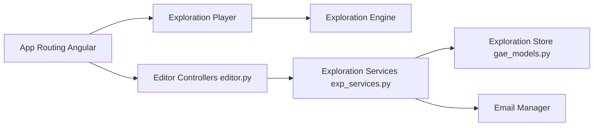

# oppia/oppia

> Online learning platform for creating interactive activities that simulate a tutor, mainly in basic mathematics.

## The problem
Students without access to educational resources need free interactive lessons with immediate feedback.

## What it actually does
Python, Angular and Google App Engine web application: authors create "explorations" (dialogue with feedback), learners follow them, contributors review and translate. The code shows an exploration engine, a question player, revision tests, e-mail and Redis storage. The README also describes free math lessons.

## How it is wired

## Trying it
No command documented in the README: it points to the "Installing Oppia" page.

## Cost and gotchas
Depends on the Google App Engine ecosystem and ancillary services (Redis, e-mail). More than 1,800 open issues.

## What it is not
Not an AI tool: the "tutor" is a hand-written script.

## Alternatives
No alternative named in the README.

## For you
Ignore: educational platform unrelated to a data/AI/MLOps workflow; interesting only as a large open-source codebase to study.
