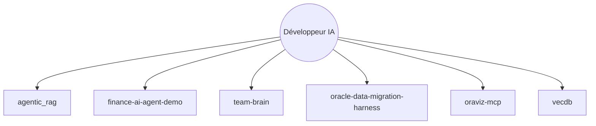

# oracle-devrel/oracle-ai-developer-hub

> Collection of applications, notebooks and workshops for building AI agents on Oracle AI Database.

## The problem
Examples of agents, RAG and agent memory are scattered. Few show a single database engine serving vectors, memory and checkpoints.

## What it actually does
A repository of independent projects: applications (multi-agent RAG, financial agent, MongoDB-to-Oracle migration, visualization MCP server), LangChain and agent-memory notebooks, conference guides and workshops. Each example has its own path, with no common runtime.

## How it is wired

## Trying it
The README gives no global command. It notes that each workshop explains how to fetch a single folder with `git sparse-checkout`.

## Cost and gotchas
Almost all examples assume Oracle AI Database 26ai, often paired with OpenAI, Anthropic, Tavily or OCI: accounts and keys are at your expense.

## What it is not
It is not an installable library nor a single platform. No license is declared, so reusing the code is legally uncertain.

## Alternatives
No alternative named in the README.

## For you
Watch: useful for picking up agent-memory and hybrid RAG patterns if you work on Oracle, but with no license and no common foundation, there is nothing to adopt as is.
