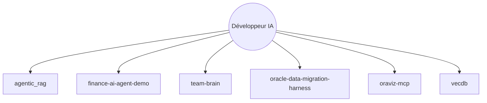

# oracle-devrel/oracle-ai-developer-hub

> Recueil d'applications, notebooks et ateliers pour construire des agents IA sur Oracle AI Database.

## Le problème
Les exemples d'agents, de RAG et de mémoire d'agent sont dispersés. Peu montrent un seul moteur de base servant les vecteurs, la mémoire et les checkpoints.

## Ce que ça fait vraiment
Dépôt de projets indépendants : applications (RAG multi-agents, agent financier, migration MongoDB vers Oracle, serveur MCP de visualisation), notebooks LangChain et mémoire d'agent, guides de conférences et ateliers. Chaque exemple a son propre parcours, sans runtime commun.

## Comment c'est branché

## Essayer
Le README n'indique aucune commande globale. Il signale que chaque atelier explique comment récupérer un seul dossier avec `git sparse-checkout`.

## Coût et pièges
Presque tous les exemples supposent Oracle AI Database 26ai, souvent associée à OpenAI, Anthropic, Tavily ou OCI : comptes et clés à ta charge.

## Ce que ce n'est pas
Ce n'est pas une bibliothèque installable ni une plateforme unique. Aucune licence n'est déclarée, donc la réutilisation du code est juridiquement incertaine.

## Alternatives
Aucune alternative nommée dans le README.

## Pour toi
Surveiller : utile pour piocher des patrons de mémoire d'agent et de RAG hybride si tu travailles sur Oracle, mais sans licence ni socle commun, rien à adopter tel quel.

