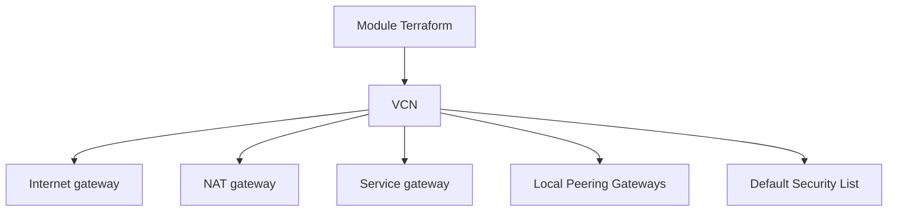

# oracle-terraform-modules/terraform-oci-vcn

> Terraform module that creates a minimal virtual network (VCN) on Oracle Cloud Infrastructure, for anyone building an OCI infrastructure.

## The problem
Setting up a VCN, its gateways and its route tables by hand on OCI is slow and hard to reproduce.

## What it actually does
Provisions a VCN with one or more CIDR blocks, an internet gateway, a NAT gateway, a service gateway, local peering gateways, and route tables. With `enable_ipv6 = true`, it adds IPv6 support. It also manages the Default Security List with a Lockdown mode.

## How it is wired
Simplified diagram based on the sheet, no diagram provided.


## Trying it
```bash
# Aucune commande dans le README : voir docs/quickstart.md du dépôt.
```

## Cost and gotchas
The module is free, the OCI resources are at your expense and you need an OCI account. Terraform must be installed.

## What it is not
Not a complete architecture: only a minimal VCN, to be extended. Not a multi-cloud module.

## Alternatives
terraform-oci-oke (cited in the README): to deploy a Kubernetes cluster on OCI, not just the network.

## For you
Worth watching only if you host AI workloads on OCI: it is a clean networking building block, otherwise of no interest.
