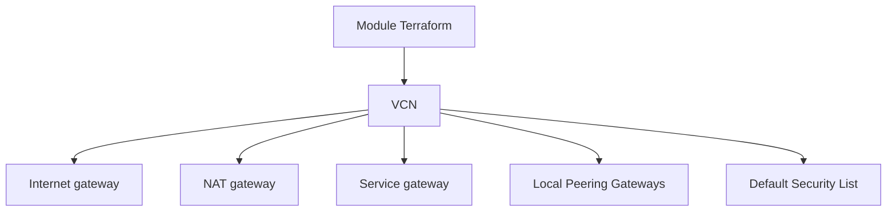

# oracle-terraform-modules/terraform-oci-vcn

> Module Terraform qui crée un réseau virtuel (VCN) minimal sur Oracle Cloud Infrastructure, pour qui bâtit une infra OCI.

## Le problème
Monter à la main un VCN, ses passerelles et ses tables de routage sur OCI est long et peu reproductible.

## Ce que ça fait vraiment
Provisionne un VCN avec un ou plusieurs blocs CIDR, une passerelle internet, une passerelle NAT, une passerelle de service, des passerelles de peering local, et des tables de routage. Avec `enable_ipv6 = true`, il ajoute le support IPv6. Il pilote aussi la Default Security List avec un mode Lockdown.

## Comment c'est branché
Schéma simplifié d'après la fiche, sans diagramme fourni.


## Essayer
```bash
# Aucune commande dans le README : voir docs/quickstart.md du dépôt.
```

## Coût et pièges
Module gratuit, les ressources OCI sont à ta charge et il faut un compte OCI. Terraform doit être installé.

## Ce que ce n'est pas
Pas une architecture complète : seulement un VCN minimal, à étendre. Pas un module multi-cloud.

## Alternatives
terraform-oci-oke (cité dans le README) : pour déployer un cluster Kubernetes sur OCI, pas seulement le réseau.

## Pour toi
À surveiller seulement si tu héberges des charges IA sur OCI : c'est une brique réseau propre, sinon sans intérêt.

