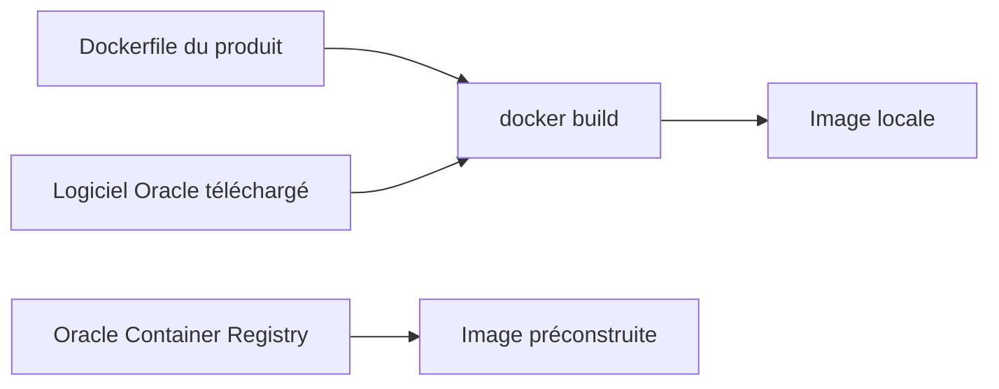

# oracle/docker-images

> Oracle's Dockerfiles and samples for building images of its commercial products and open source projects.

## The problem
Cleanly installing Oracle products (database, WebLogic, GoldenGate) in containers requires vendor-maintained Dockerfiles.

## What it actually does
A directory of Dockerfiles and samples per product: Access Management, BI, Database, Coherence, GoldenGate, Java, REST Data Services, SOA Suite, WebLogic, Tuxedo, etc. You must download the commercial software yourself before building. For images already stocked with the software, the README points to Oracle's container registry, with license acceptance.

## How it is wired
Simplified diagram based on the fiche, no diagram provided.

## Trying it
No command in the README: it is limited to listing the products and pointing to each one's folder.

## Cost and gotchas
The Dockerfiles are free (UPL-1.0) but the targeted software is commercial: Oracle license and an account for downloading. Several listed projects are archived (ContainerCloud, Data Integrator).

## What it is not
Not a collection of ready-to-run images, except via the Oracle registry. Nothing specific to AI or data science in the ML sense.

## Alternatives
No alternative named in the README.

## For you
Ignore for a data / AI / MLOps profile, unless your company runs Oracle products: the real cost comes from licenses, not from the repository.
