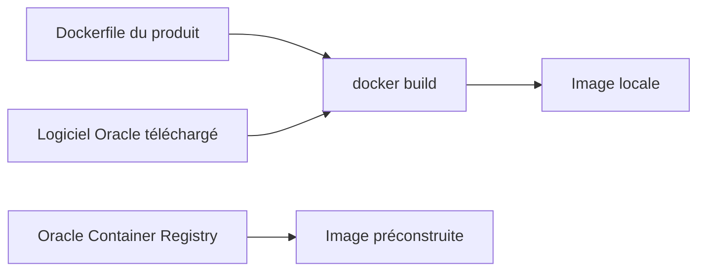

# oracle/docker-images

> Dockerfiles et exemples d'Oracle pour construire des images de ses produits commerciaux et projets open source.

## Le problème
Installer proprement des produits Oracle (base de données, WebLogic, GoldenGate) dans des conteneurs demande des Dockerfiles maintenus par l'éditeur.

## Ce que ça fait vraiment
Un répertoire de Dockerfiles et d'exemples par produit : Access Management, BI, Database, Coherence, GoldenGate, Java, REST Data Services, SOA Suite, WebLogic, Tuxedo, etc. Il faut télécharger soi-même le logiciel commercial avant la construction. Pour des images déjà garnies du logiciel, le README renvoie au registre de conteneurs d'Oracle, avec acceptation de licence.

## Comment c'est branché
Schéma simplifié d'après la fiche, sans diagramme fourni.

## Essayer
Aucune commande dans le README : il se limite à lister les produits et à renvoyer vers les dossiers de chacun.

## Coût et pièges
Les Dockerfiles sont libres (UPL-1.0) mais les logiciels visés sont commerciaux : licence Oracle et compte pour le téléchargement. Plusieurs projets listés sont archivés (ContainerCloud, Data Integrator).

## Ce que ce n'est pas
Pas une collection d'images prêtes à lancer, sauf via le registre Oracle. Rien de spécifique à l'IA ou à la data science au sens ML.

## Alternatives
Aucune alternative nommée dans le README.

## Pour toi
À ignorer pour un profil data / IA / MLOps, sauf si ton entreprise exploite des produits Oracle : le coût réel vient des licences, pas du dépôt.

