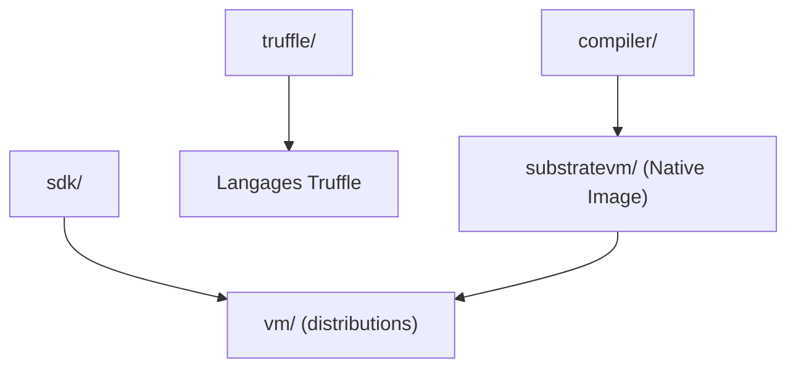

# oracle/graal

> Java virtual machine and compiler that produces native binaries, for those who want fast startup and low memory use.

## The problem
Java applications start slowly and consume memory because of the classic JVM.

## What it actually does
GraalVM compiles applications ahead of time into standalone binaries (Native Image) and is used like a JDK. The repository contains the Graal compiler, Truffle (language framework), Espresso, TRegex, Sulong, GraalWasm and a graph visualizer. GraalPy and GraalJS live in other repositories.

## How it is wired
Simplified diagram based on the sheet, no diagram provided.

## Trying it
No command documented in the README: the build is described in `vm/README.md` and on the website.

## Cost and gotchas
Free. Building from source is heavy. License present but not identified by GitHub: verify (several components).

## What it is not
Not a simple JDK: it is a monorepo of components, whose internal CI is not usable from outside. Python goes through GraalPy, another repository.

## Alternatives
- GraalPy (named in the README): a Python implementation on GraalVM.

## For you
Watch: useful only if you deploy Java or look for lightweight native binaries, outside the core data/AI work.
