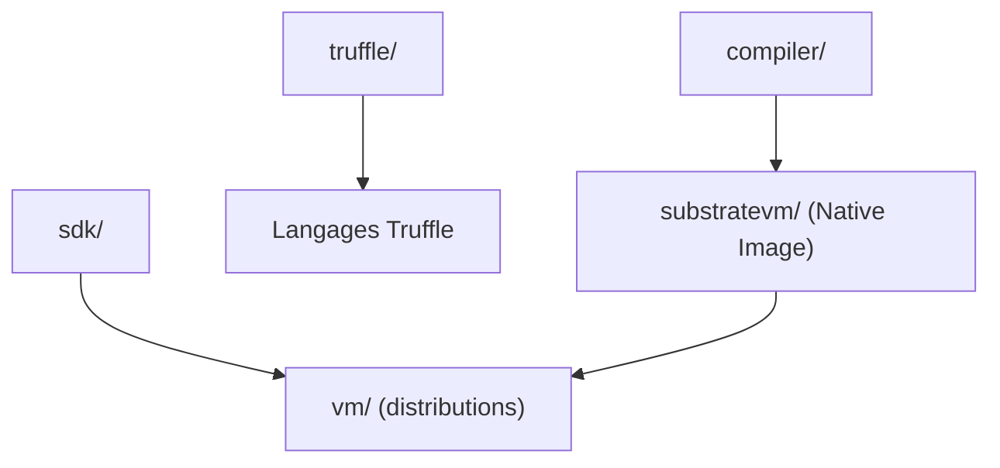

# oracle/graal

> Machine virtuelle et compilateur Java qui produit des binaires natifs, pour qui veut démarrage rapide et peu de mémoire.

## Le problème
Les applications Java démarrent lentement et consomment de la mémoire à cause de la JVM classique.

## Ce que ça fait vraiment
GraalVM compile les applications à l'avance en binaires autonomes (Native Image) et s'utilise comme un JDK. Le dépôt contient le compilateur Graal, Truffle (framework de langages), Espresso, TRegex, Sulong, GraalWasm et un visualiseur de graphes. GraalPy et GraalJS vivent dans d'autres dépôts.

## Comment c'est branché
Schéma simplifié d'après la fiche, sans diagramme fourni.

## Essayer
Aucune commande documentée dans le README : la construction est décrite dans `vm/README.md` et le site web.

## Coût et pièges
Gratuit. Construire depuis les sources est lourd. Licence présente mais non identifiée par GitHub : à vérifier (plusieurs composants).

## Ce que ce n'est pas
Pas un simple JDK : c'est un monorepo de composants, dont la CI interne n'est pas utilisable de l'extérieur. Python passe par GraalPy, autre dépôt.

## Alternatives
- GraalPy (nommé dans le README) : implémentation de Python sur GraalVM.

## Pour toi
À surveiller : utile seulement si tu déploies du Java ou cherches des binaires natifs légers, hors cœur de métier data/IA.

