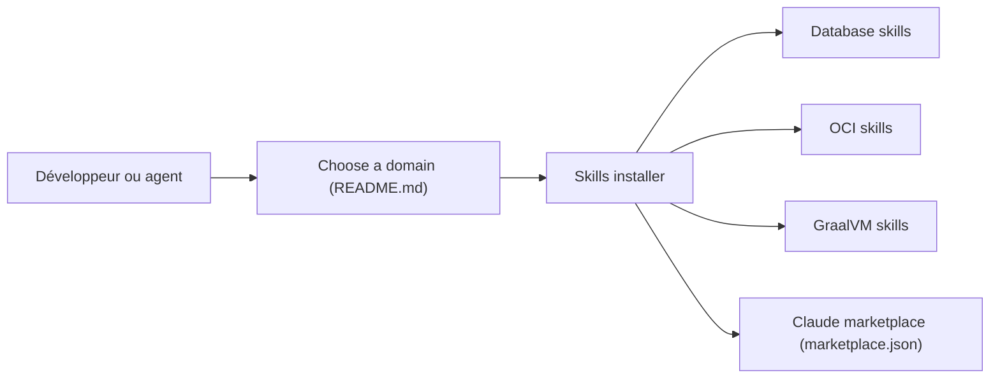

# oracle/skills

> Installable skills to guide developers and agents on Oracle Database, OCI, GraalVM and APEX.

## The problem
Agents give approximate advice on Oracle products and their versions (19c versus 26ai).

## What it actually does
A repository of domains: db (ORDS, SQLcl, VecDB, PL/SQL), oci (Functions, OKE, IoT, enterprise AI), graal (Native Image), plus fusion and apex, still empty. Each domain has an entry-point SKILL.md. It installs with npx skills or as a Claude Code plugin marketplace. Versioned skills must have a 19c versus 26ai section.

## How it is wired


## Trying it
```bash
npx skills add oracle/skills/db
/plugin marketplace add oracle/skills
/plugin install db@oracle-skills
```

## Cost and gotchas
Free; the targeted Oracle products are often paid. Fusion and APEX are skeletons. UPL-1.0 license, permissive.

## What it is not
Not an executable tool or a database connector: guidance content. The quality of the sources is not measured in the README.

## Alternatives
No alternative named in the README.

## For you
Ignore unless you operate on Oracle (notably VecDB or OCI): otherwise, nothing for your daily work.
