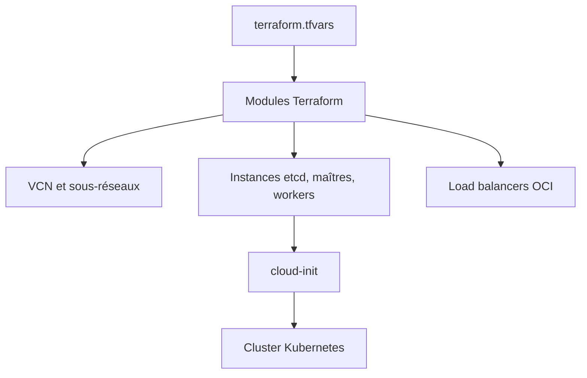

# oracle/terraform-kubernetes-installer

> Terraform modules that install a highly available Kubernetes cluster on Oracle Cloud Infrastructure.

## The problem
Setting up a Kubernetes cluster by hand (network, etcd, masters, workers) on OCI is slow and fragile.

## What it actually does
Provisions a VCN, etcd, master and worker instances per availability domain, and load balancers, then configures everything through cloud-init scripts (HA, RBAC, dashboard, kube-DNS, OCI cloud manager, optional GPU support). A `cluster-check.sh` script verifies the cluster. Scaling etcd after the fact is not supported.

## How it is wired
Simplified diagram based on the fiche, no diagram provided.



## Trying it
```bash
cp terraform.example.tfvars terraform.tfvars
terraform init
terraform plan
terraform apply
scripts/cluster-check.sh
```

## Cost and gotchas
OCI account, OCI Terraform provider and Terraform v0.10.3 or later. OCI resources are billed. Load balancers and volumes created by Kubernetes block the destruction of the VCN.

## What it is not
Not a managed Kubernetes service. Archived repo, aligned with Terraform 0.10.

## Alternatives
None cited in the README.

## For you
Ignore: a 2017-2019 installer, archived, tied to a single cloud and to long-outdated Terraform versions.
