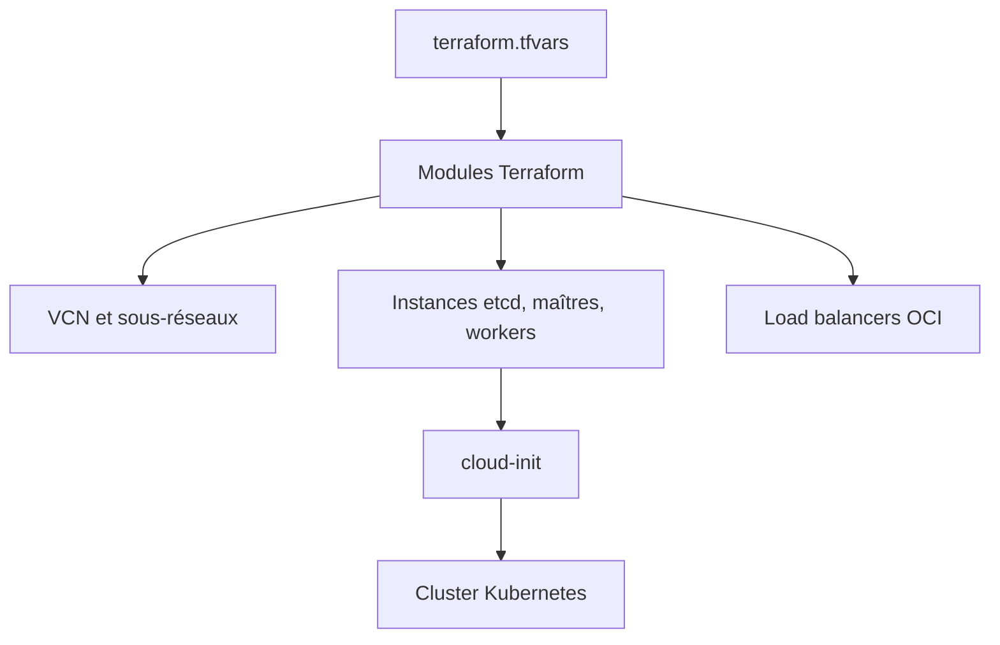

# oracle/terraform-kubernetes-installer

> Modules Terraform installant un cluster Kubernetes hautement disponible sur Oracle Cloud Infrastructure.

## Le problème
Monter à la main un cluster Kubernetes (réseau, etcd, maîtres, workers) sur OCI est long et fragile.

## Ce que ça fait vraiment
Provisionne un VCN, des instances etcd, maîtres et workers par domaine de disponibilité, des load balancers, puis configure le tout via des scripts cloud-init (HA, RBAC, dashboard, kube-DNS, gestionnaire de cloud OCI, support GPU optionnel). Un script `cluster-check.sh` vérifie le cluster. La mise à l'échelle d'etcd après coup n'est pas supportée.

## Comment c'est branché
Schéma simplifié d'après la fiche, sans diagramme fourni.



## Essayer
```bash
cp terraform.example.tfvars terraform.tfvars
terraform init
terraform plan
terraform apply
scripts/cluster-check.sh
```

## Coût et pièges
Compte OCI, fournisseur Terraform OCI et Terraform v0.10.3 ou plus. Les ressources OCI sont facturées. Les load balancers et volumes créés par Kubernetes bloquent la destruction du VCN.

## Ce que ce n'est pas
Pas un service Kubernetes managé. Dépôt archivé, aligné sur Terraform 0.10.

## Alternatives
Aucune citée dans le README.

## Pour toi
À ignorer : installeur de 2017-2019, archivé, lié à un seul cloud et à des versions Terraform depuis longtemps dépassées.

