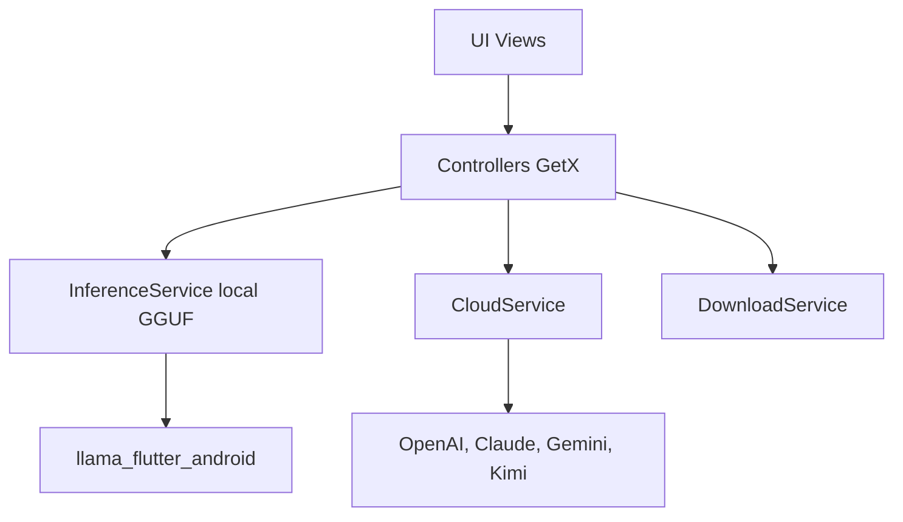

# orailnoor/cross-platform-llm-client

> Flutter chat client (PrivateLM) mixing local inference on Android with cloud APIs.

## The problem
Chatting with an LLM on a phone, either offline with a local model or through a cloud provider, in a single application.

## What it actually does
On Android, downloads and runs GGUF models through a plugin wrapping llama.cpp, with Vulkan acceleration. As a fallback, uses OpenAI, Anthropic, Gemini or Kimi. Handles multimodal input (text and images), stores chats and settings in Hive, and picks the context size according to the detected RAM. The tasks view is announced as under development.

## How it is wired


## Trying it
```bash
flutter pub get
flutter build apk --debug
flutter build web --release
```

## Cost and gotchas
Cloud API keys are at your expense. Local models consume RAM and storage. On iOS: installation through AltStore, which expires after 7 days. A stable signing key is required for release APKs.

## What it is not
Not local inference on the web (cloud only). The README calls itself "production-ready", which nothing here proves.

## Alternatives
No alternative named in the README.

## For you
Worth watching: curious for testing small models on mobile, but recent, single-maintainer and with no performance measurements.
