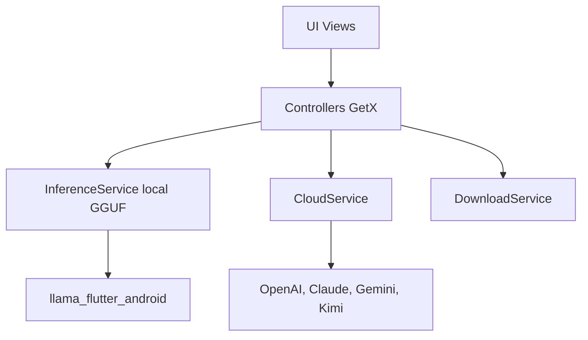

# orailnoor/cross-platform-llm-client

> Client de chat Flutter (PrivateLM) mêlant inférence locale sur Android et API cloud.

## Le problème
Discuter avec un LLM sur téléphone, soit hors ligne avec un modèle local, soit via un fournisseur cloud, dans une même application.

## Ce que ça fait vraiment
Sur Android, télécharge et exécute des modèles GGUF via un plugin enveloppant llama.cpp, avec accélération Vulkan. En repli, utilise OpenAI, Anthropic, Gemini ou Kimi. Gère le multimodal (texte et images), stocke chats et réglages dans Hive, et choisit le contexte selon la RAM détectée. La vue des tâches est annoncée en développement.

## Comment c'est branché


## Essayer
```bash
flutter pub get
flutter build apk --debug
flutter build web --release
```

## Coût et pièges
Clés d'API cloud à ta charge. Les modèles locaux consomment RAM et stockage. Sur iOS : installation par AltStore, expirant après 7 jours. Une clé de signature stable est nécessaire pour les APK de release.

## Ce que ce n'est pas
Pas une inférence locale sur le web (cloud seulement). Le README se dit « production-ready », ce que rien ne prouve ici.

## Alternatives
Aucune alternative nommée dans le README.

## Pour toi
À surveiller : curieux pour tester des petits modèles sur mobile, mais récent, mono-mainteneur et sans mesure de performance.

