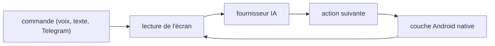

# orailnoor/private-agent

> Flutter Android agent that controls any application through natural-language commands.

## The problem
Chaining repetitive gestures in mobile applications is done by hand, with no general automation.

## What it actually does
Reads the Android interface tree through the accessibility service, sends the layout to a model (DeepSeek or OpenRouter), receives the next action (tap, typing, scroll) and executes it, looping until done. Commands by voice, text or a Telegram bot polled in the background.

## How it is wired

## Trying it
No command documented: download the `app-universal-release.apk` APK from the releases page, then OpenRouter settings, API key, model `openai/gpt-oss-120b:free` and enabling the "PrivateAgent Screen Control" service.

## Cost and gotchas
Free with OpenRouter's free models, otherwise the API key is at your expense. Your phone's screen is sent to a third-party provider: a privacy risk, despite the name. Android blocks accessibility for sideloaded APKs: "Allow restricted settings" must be enabled. No license.

## What it is not
Not "private" in the local sense: the analysis is done at a remote provider. Not available on a store, only as an APK.

## Alternatives
No alternative named in the README.

## For you
Ignore: no license, a single author, and the entire screen goes to a third party; too risky to give your phone to.
