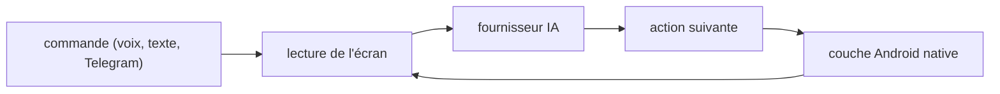

# orailnoor/private-agent

> Agent Android en Flutter qui pilote n'importe quelle application par commande en langage naturel.

## Le problème
Enchaîner des gestes répétitifs dans des applications mobiles se fait à la main, sans automatisation générale.

## Ce que ça fait vraiment
Lit l'arbre de l'interface Android via le service d'accessibilité, envoie la disposition à un modèle (DeepSeek ou OpenRouter), reçoit l'action suivante (toucher, saisie, défilement) et l'exécute, en boucle jusqu'à la fin. Commandes par voix, texte ou bot Telegram interrogé en arrière-plan.

## Comment c'est branché

## Essayer
Aucune commande documentée : télécharger l'APK `app-universal-release.apk` depuis la page des releases, puis réglages d'OpenRouter, clé d'API, modèle `openai/gpt-oss-120b:free` et activation du service « PrivateAgent Screen Control ».

## Coût et pièges
Gratuit avec les modèles gratuits d'OpenRouter, sinon clé d'API à ta charge. L'écran de ton téléphone est envoyé à un fournisseur tiers : risque pour la vie privée, malgré le nom. Android bloque l'accessibilité pour les APK : « Allow restricted settings » à activer. Aucune licence.

## Ce que ce n'est pas
Pas « privé » au sens local : l'analyse se fait chez un fournisseur distant. Pas disponible sur un store, seulement en APK.

## Alternatives
Aucune alternative nommée dans le README.

## Pour toi
Ignorer : aucune licence, un seul auteur, et l'écran entier part chez un tiers ; trop risqué à donner à ton téléphone.

