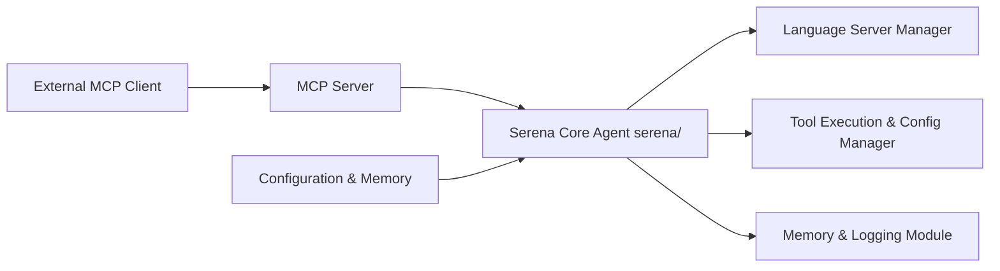

# oraios/serena

> MCP server giving code agents semantic IDE tools (symbols, references, refactorings).

## The problem
Code agents manipulate text by lines and regexes: renaming or moving a symbol across files becomes costly and fragile.

## What it actually does
Exposes symbol-level tools via MCP: find a symbol, its references, replace a body, insert before/after, rename.
Two backends: LSP servers (40+ languages) or a paid JetBrains plugin (move, inline, interactive debugging).
Includes a project memory system and multi-level YAML configuration (global, project, context, modes).
Installed with `uv`, launched by the client (Claude Code, Codex, Cursor…) or in HTTP mode.

## How it is wired


## Trying it
```bash
uv tool install -p 3.13 serena-agent
serena init
```

## Cost and gotchas
Free with the LSPs; some languages require additional dependencies. The JetBrains plugin is paid. Do not install via an MCP marketplace (outdated commands according to the README).

## What it is not
Not an autonomous agent: you need an LLM and an MCP client. Advanced refactoring features (move, inline) exist only with the paid plugin.

## Alternatives
No alternative named in the README.

## For you
Adopt: if you work with Claude Code or Codex on large Python repositories, it is the most direct gain in refactoring reliability — only check the license before enterprise use.
