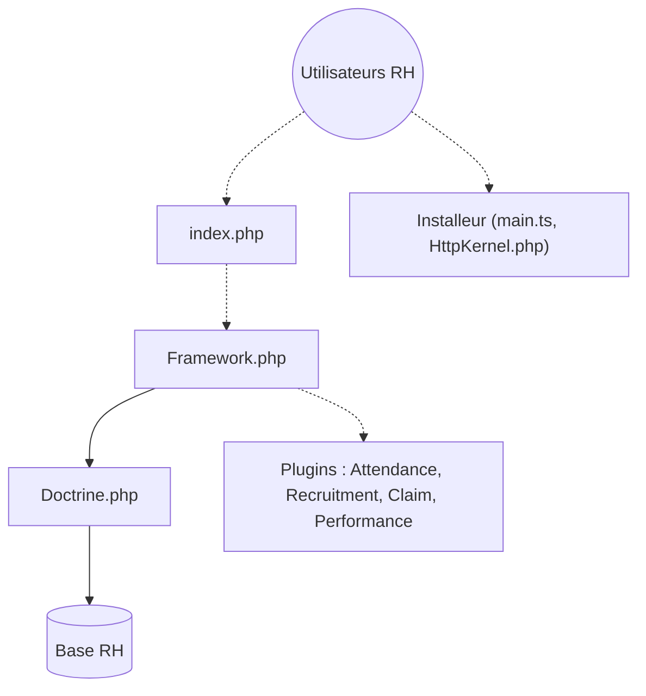

# orangehrm/orangehrm

> Open-source web application for human resources management, for companies that host their own HR information system.

## The problem
Managing attendance, recruitment, expense claims and performance reviews in spreadsheets or scattered tools.

## What it actually does
PHP application organized in modules: administration, directory, attendance, recruitment, expense claims, performance reviews and social feed. Data access goes through the Doctrine ORM. A web installer handles installation and updates. The repository also contains instructions for coding agents in `.agents/`.

## How it is wired


## Trying it
```bash
# Pas de commande dans le README : téléchargement de la version
# puis installation via l'installeur web (guides Linux et Windows liés).
# Démo en ligne : https://opensource-demo.orangehrmlive.com
```

## Cost and gotchas
Free; you need a PHP server and a database to host yourself. The prerequisite details are in external guides, not reproduced in the README.

## What it is not
Not a data or AI tool. GPL-3.0 license: redistributed modifications must remain under GPL. Several links in the diagram are dotted, so the wiring is not entirely confirmed.

## Alternatives
No alternative named in the README.

## For you
Ignore: it is general-purpose HR software with no link to data, AI or MLOps work, unless you have a specific internal need.
