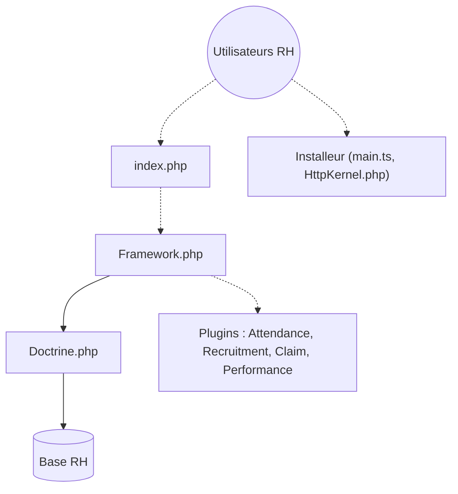

# orangehrm/orangehrm

> Application web libre de gestion des ressources humaines, pour les entreprises qui hébergent leur propre SI RH.

## Le problème
Gérer présences, recrutement, notes de frais et évaluations dans des tableurs ou des outils dispersés.

## Ce que ça fait vraiment
Application PHP organisée en modules : administration, annuaire, présences, recrutement, notes de frais, évaluations de performance et fil social. L'accès aux données passe par l'ORM Doctrine. Un installeur web gère installation et mise à jour. Le dépôt contient aussi des consignes pour agents de code dans `.agents/`.

## Comment c'est branché


## Essayer
```bash
# Pas de commande dans le README : téléchargement de la version
# puis installation via l'installeur web (guides Linux et Windows liés).
# Démo en ligne : https://opensource-demo.orangehrmlive.com
```

## Coût et pièges
Gratuit ; il faut un serveur PHP et une base de données à héberger soi-même. Le détail des prérequis est dans des guides externes, non reproduits dans le README.

## Ce que ce n'est pas
Pas un outil data ni IA. Licence GPL-3.0 : les modifications redistribuées doivent rester sous GPL. Plusieurs liens du schéma sont en pointillé, donc le câblage n'est pas tout confirmé.

## Alternatives
Aucune alternative nommée dans le README.

## Pour toi
À ignorer : c'est un logiciel RH généraliste sans lien avec un travail data, IA ou MLOps, sauf besoin interne précis.

