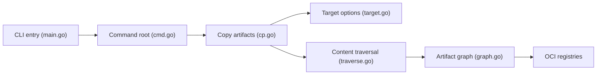

# oras-project/oras

> CLI to push, pull and copy OCI artifacts to registries; minimal card, nearly empty README.

## The problem
Not documented in the README, which points to oras.land/cli.

## What it actually does
Based on the architecture drawn from the code: pull/push commands, copying artifacts between registries and OCI layouts (`cp`, with graph-copy options and extra tags), discovery, manifests, blobs, repositories, backup/restore and authentication, with formatted output and progress display.

## How it is wired

## Trying it
No command documented in the README; see https://oras.land/cli.

## Cost and gotchas
Not documented in the README.

## What it is not
Not documentation: the README contains only a link and a development guide.

## Alternatives
No alternative named in the README.

## For you
Keep an eye on it: useful for storing models and artifacts in an OCI registry, but the README does not allow a firmer judgment.
