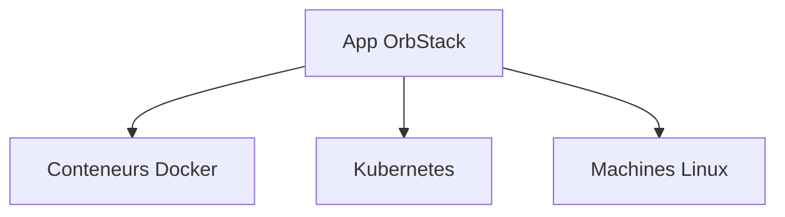

# orbstack/orbstack

> Fast alternative to Docker Desktop and WSL for running containers and Linux machines on Mac.

## The problem
Docker Desktop is heavy and slow to start for a developer on a local machine.

## What it actually does
Native Swift application that runs Docker containers, Kubernetes and Linux distributions. The README highlights a 2-second startup, low CPU and disk usage, automatic domain names, and CLI and filesystem integration. The repository does not describe the code.

## How it is wired

Diagram not provided: list deduced from the README.

## Trying it
```bash
# Aucune commande documentée dans le README : voir le site pour installer.
```

## Cost and gotchas
The README does not mention pricing. The repository has almost no visible code, and the last push was in August 2025.

## What it is not
It is not an open project in the usual sense: the repository mainly serves to track issues. Not designed for GPUs or clusters.

## Alternatives
Docker Desktop and WSL are cited as the tools it replaces.

## For you
Ignore: a local workstation tool with nothing specific for data / AI, and a barely active repository.
