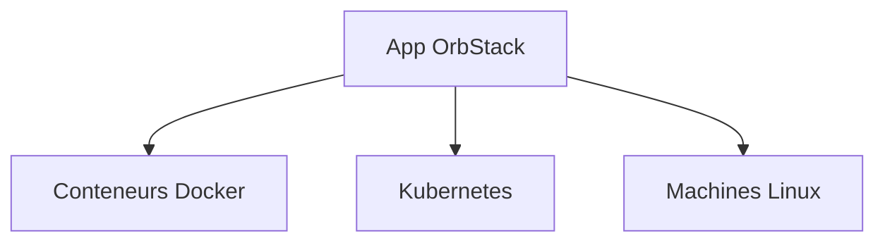

# orbstack/orbstack

> Alternative rapide à Docker Desktop et WSL pour lancer conteneurs et machines Linux sur Mac.

## Le problème
Docker Desktop est lourd et lent à démarrer pour un développeur sur poste local.

## Ce que ça fait vraiment
Application native Swift qui exécute des conteneurs Docker, Kubernetes et des distributions Linux. Le README met en avant démarrage en 2 secondes, faible usage CPU et disque, noms de domaine automatiques, intégration CLI et système de fichiers. Le dépôt ne décrit pas le code.

## Comment c'est branché

Schéma non fourni : liste déduite du README.

## Essayer
```bash
# Aucune commande documentée dans le README : voir le site pour installer.
```

## Coût et pièges
Le README ne parle pas de tarif. Dépôt quasi sans code visible, et dernier push d'août 2025.

## Ce que ce n'est pas
Ce n'est pas un projet ouvert au sens usuel : le dépôt sert surtout au suivi des issues. Pas pensé pour des GPU ou des clusters.

## Alternatives
Docker Desktop et WSL sont cités comme les outils remplacés.

## Pour toi
Ignorer : outil de poste local sans apport spécifique data / IA, et dépôt peu actif.

