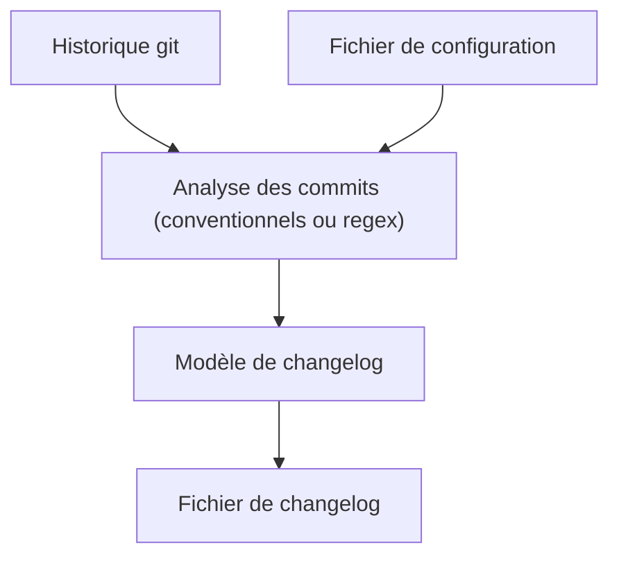

# orhun/git-cliff

> Changelog generator based on git history and conventional commits, with customizable templates.

## The problem
Writing a changelog by hand for every release is repetitive and often forgotten.

## What it actually does
Reads the git history, parses conventional commits or custom regexes, and produces a changelog file from a configurable template. The README points to the documentation for installation, usage, configuration and templates, and mentions monorepo support. The README provided does not detail the internal workings.

## How it is wired
Simplified diagram based on the sheet, no diagram provided.

## Trying it
No command documented in the README provided: it points to the official documentation (installation, usage, configuration, templates).

## Cost and gotchas
Free. The quality of the result depends on the team's commit message discipline. Installation details are outside the README provided.

## What it is not
It is not a release publishing tool: it generates the changelog. It does not fix malformed commits without suitable regex rules.

## Alternatives
- cocogitto: CLI tools for conventional commits and semver.
- release-plz: publishes Rust packages from CI.
- git-changelog: generator based on Jinja2 templates.

## For you
To adopt: automatic changelogs for your model and pipeline repositories, with a single versioned configuration.
