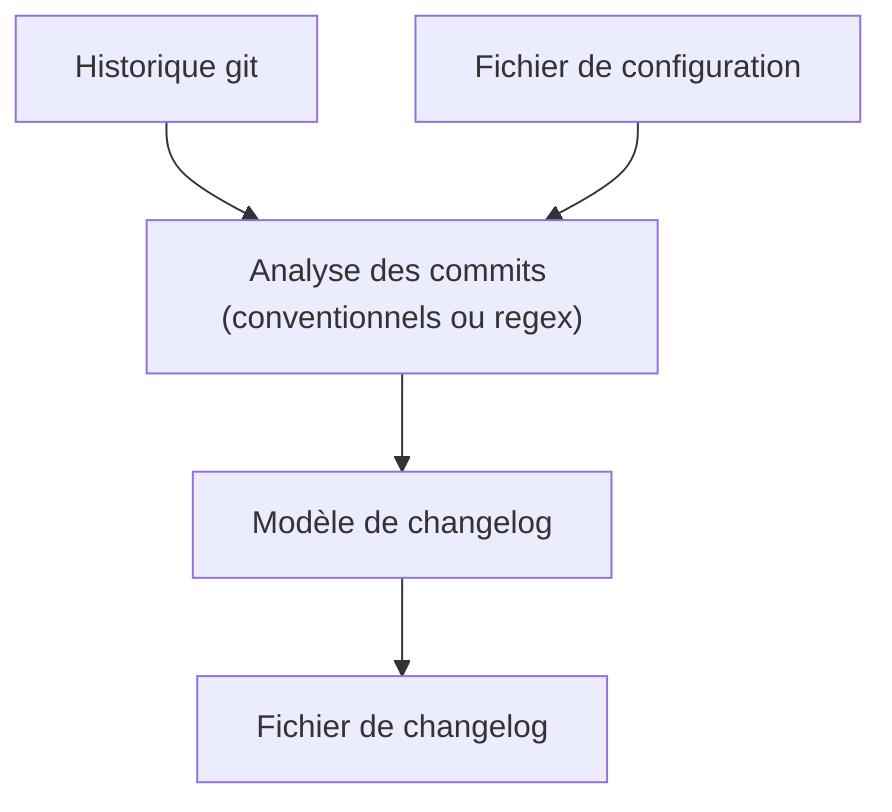

# orhun/git-cliff

> Générateur de changelog à partir de l'historique git et des commits conventionnels, avec modèles personnalisables.

## Le problème
Rédiger un changelog à la main à chaque version est répétitif et souvent oublié.

## Ce que ça fait vraiment
Lit l'historique git, analyse les commits conventionnels ou des regex personnalisées, et produit un fichier de changelog selon un modèle configurable. Le README renvoie à la documentation pour l'installation, l'usage, la configuration et les modèles, et mentionne la prise en charge des monorepos. Le README fourni ne détaille pas le fonctionnement interne.

## Comment c'est branché
Schéma simplifié d'après la fiche, sans diagramme fourni.

## Essayer
Aucune commande documentée dans le README fourni : il renvoie à la documentation officielle (installation, usage, configuration, modèles).

## Coût et pièges
Gratuit. La qualité du résultat dépend de la discipline de messages de commit de l'équipe. Les détails d'installation sont hors du README fourni.

## Ce que ce n'est pas
Ce n'est pas un outil de publication de versions : il génère le changelog. Il ne corrige pas des commits mal formés sans règles regex adaptées.

## Alternatives
- cocogitto : outils CLI pour commits conventionnels et semver.
- release-plz : publie des paquets Rust depuis la CI.
- git-changelog : générateur basé sur des modèles Jinja2.

## Pour toi
À adopter : changelogs automatiques pour tes dépôts de modèles et pipelines, avec une seule configuration versionnée.

