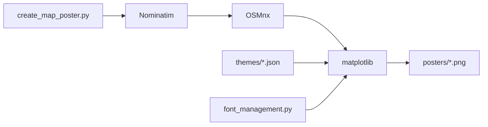

# originalankur/maptoposter

> Python script that generates minimalist map posters of any city, for creatives.

## The problem
Making a stylized poster of a city map usually takes GIS work or manual design.

## What it actually does
A `create_map_poster.py` script geocodes the city via Nominatim, downloads roads, water and parks via OSMnx, then composes a PNG image with matplotlib. 17 JSON themes, adjustable sizes, Google fonts downloaded for non-Latin scripts. Output goes to `posters/`.

## How it is wired


## Trying it
```bash
uv run ./create_map_poster.py --city "Paris" --country "France"
python create_map_poster.py -c "New York" -C "USA" -t noir -d 12000
python create_map_poster.py --list-themes
```

## Cost and gotchas
Free; needs network access (Nominatim, OSM, Google Fonts). Beyond a 20 km radius: slow downloads and high memory use. Nominatim rate limits.

## What it is not
Not a library or a service: a single script validated mostly by eye.

## Alternatives
No alternative cited in the README.

## For you
Watch: fun for visualizing geographic data, but there is a single maintainer (inferred from the owner's name) and the use remains decorative.
