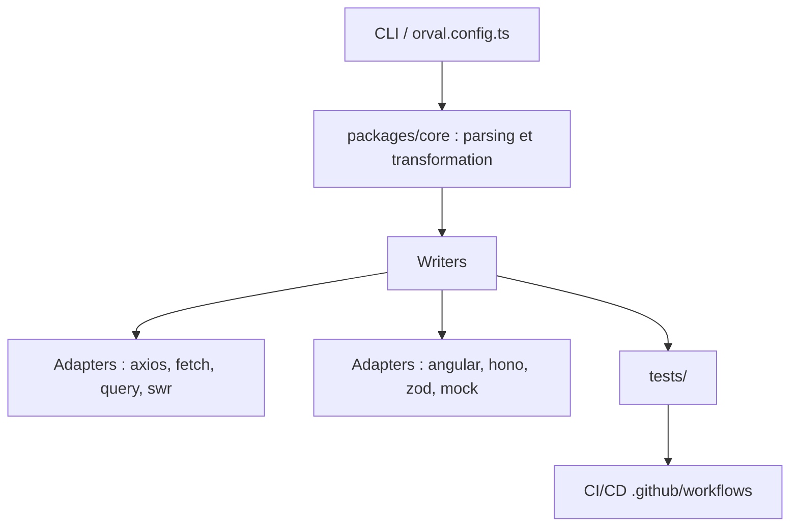

# orval-labs/orval

> Generator of typed TypeScript clients from an OpenAPI or Swagger specification, for front-end teams.

## The problem
Hand-writing API calls and their types quickly drifts from the server's specification. Every endpoint change silently breaks the client.

## What it actually does
Orval reads an OpenAPI v3 or Swagger v2 specification (yaml or json) and writes TypeScript client code. A central engine (`packages/core`) parses the specification, then adapters produce the code for axios, fetch, React Query, SWR, Angular, Hono, Zod or mocks. Configuration goes through an `orval.config.ts` file.

## How it is wired


## Trying it
```bash
# image Docker officielle, depuis le dossier du projet (macOS / Linux)
docker run --rm -v "$(pwd):/app" -w /app ghcr.io/orval-labs/orval
```

## Cost and gotchas
Free. Version 8 requires Node.js 22.18 or newer; otherwise you must use the Docker image. Version 8.0.0 changes a lot of things: read the migration guide.

## What it is not
It is not a server or an API testing tool: it generates client-side code from a specification. The quality of the result depends on that of the supplied specification.

## Alternatives
No alternative named in the README.

## For you
Watch: useful if you consume a REST API from a TypeScript interface, little value for work centered on models or data pipelines.
