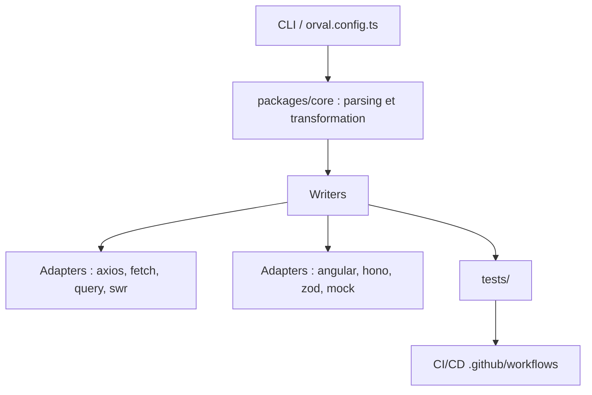

# orval-labs/orval

> Générateur de clients TypeScript typés à partir d'une spécification OpenAPI ou Swagger, pour les équipes front.

## Le problème
Écrire à la main les appels d'API et leurs types dérive vite de la spécification du serveur. Chaque changement d'endpoint casse silencieusement le client.

## Ce que ça fait vraiment
Orval lit une spécification OpenAPI v3 ou Swagger v2 (yaml ou json) et écrit du code client TypeScript. Un moteur central (`packages/core`) analyse la spécification, puis des adaptateurs produisent le code pour axios, fetch, React Query, SWR, Angular, Hono, Zod ou des mocks. La configuration passe par un fichier `orval.config.ts`.

## Comment c'est branché


## Essayer
```bash
# image Docker officielle, depuis le dossier du projet (macOS / Linux)
docker run --rm -v "$(pwd):/app" -w /app ghcr.io/orval-labs/orval
```

## Coût et pièges
Gratuit. La version 8 demande Node.js 22.18 ou plus récent ; sinon il faut passer par l'image Docker. La version 8.0.0 change beaucoup de choses : lire le guide de migration.

## Ce que ce n'est pas
Ce n'est pas un serveur ni un outil de test d'API : il génère du code côté client à partir d'une spécification. La qualité du résultat dépend de celle de la spécification fournie.

## Alternatives
Aucune alternative nommée dans le README.

## Pour toi
À surveiller : utile si tu consommes une API REST depuis une interface TypeScript, peu de valeur pour un travail centré sur les modèles ou les pipelines de données.

