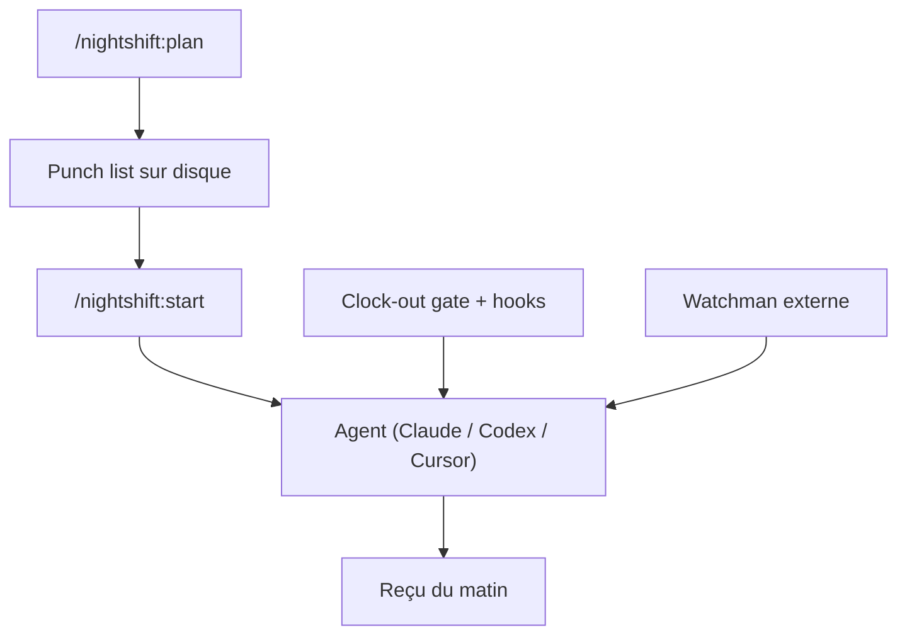

# orwa-mahmoud/nightshift

> Plugin for Claude Code, Codex and Cursor that makes an agent work through a task list overnight.

## The problem
A coding agent stops, loses the thread at compaction or at a usage limit, and the context of a long session is lost.

## What it actually does
Installed as a native plugin, it structures a "shift": a read-only planning room, a task list (punch list) on disk, item-by-item execution with one commit per item. A clock-out gate sends the agent back to the list if it tries to stop too early, and an external "watchman" resumes after a crash or limit. At the end, a morning receipt summarizes time, tokens, decisions and evidence.

## How it is wired
Simplified diagram based on the note, no diagram provided.



## Trying it
```text
/plugin marketplace add orwa-mahmoud/nightshift
/plugin install nightshift@nightshift
/nightshift:setup
```
```bash
codex plugin marketplace add orwa-mahmoud/nightshift
codex plugin add nightshift@nightshift
```

## Cost and gotchas
No API key of its own, but the token consumption of your host agent remains at your expense. You must approve the hooks, and an unattended shift requires setting permissions so it does not get blocked.

## What it is not
Not an agent: it drives the ones you already have. Not a quality guarantee: the evidence is for you to judge.

## Alternatives
No alternative named in the README.

## For you
Worth watching: useful for refactoring or debt-cleanup work, but recent and carried by a single maintainer.
