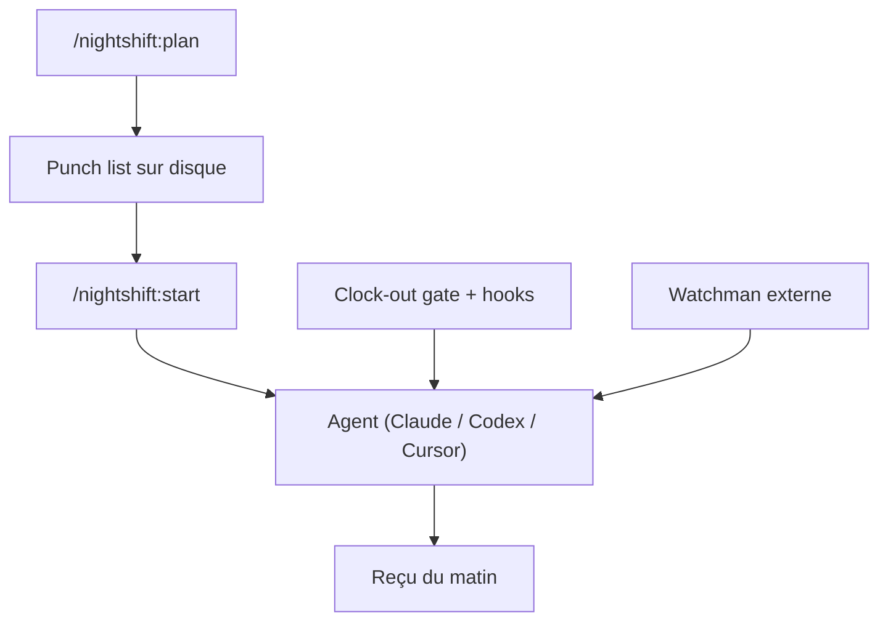

# orwa-mahmoud/nightshift

> Plugin pour Claude Code, Codex et Cursor qui fait travailler un agent sur une liste de tâches pendant la nuit.

## Le problème
Un agent de code s'arrête, perd le fil à la compaction ou à une limite d'usage, et on perd le contexte d'une longue session.

## Ce que ça fait vraiment
Installé comme plugin natif, il structure un « shift » : salle de planification en lecture seule, liste de tâches (punch list) sur disque, exécution item par item avec un commit par item. Une porte de sortie renvoie l'agent à la liste s'il veut s'arrêter trop tôt, et un « watchman » externe reprend après plantage ou limite. À la fin, un reçu du matin résume temps, jetons, décisions et preuves.

## Comment c'est branché
Schéma simplifié d'après la fiche, sans diagramme fourni.



## Essayer
```text
/plugin marketplace add orwa-mahmoud/nightshift
/plugin install nightshift@nightshift
/nightshift:setup
```
```bash
codex plugin marketplace add orwa-mahmoud/nightshift
codex plugin add nightshift@nightshift
```

## Coût et pièges
Pas de clé d'API propre, mais la consommation de jetons de ton agent hôte reste à ta charge. Il faut approuver les hooks, et un shift sans surveillance exige de régler les permissions pour qu'il ne se bloque pas.

## Ce que ce n'est pas
Pas un agent : il pilote ceux que tu as déjà. Pas une garantie de qualité : les preuves sont à juger par toi.

## Alternatives
Aucune alternative nommée dans le README.

## Pour toi
À surveiller : utile pour des chantiers de refactoring ou de dette, mais récent et porté par un seul mainteneur.

