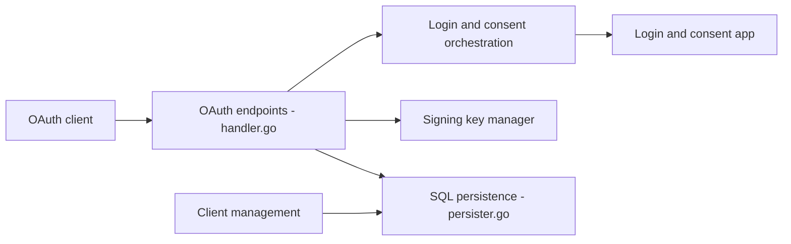

# ory/hydra

> Certified OAuth 2.0 server and OpenID Connect provider, which delegates login to your application.

## The problem
Implementing OAuth2 and OIDC correctly is hard (more than 400 pages of specifications), and you want to keep control of the login interface.

## What it actually does
Standalone server with no user management: it orchestrates login and consent flows with an external application, issues and validates tokens, manages clients and JWKS, device authorization and JWT grants. SQL persistence (PostgreSQL, MySQL, CockroachDB), key manager with a hardware option. Available self-hosted or on Ory Network.

## How it is wired


## Trying it
```bash
bash <(curl https://raw.githubusercontent.com/ory/meta/master/install.sh) -b . ory
ory auth
ory create project --create-workspace "Ory Open Source" --name "GitHub Quickstart" --use-project
ory create oauth2-client --name "Client Credentials Demo" --grant-type client_credentials
```

## Cost and gotchas
The quickstart goes through an Ory Network account. For critical production, the README recommends the Ory Enterprise License (CVEs under SLA, features absent from the free version). Anonymous telemetry, which can be disabled.

## What it is not
Not an identity manager: no users or passwords, that is the role of Kratos or your own system.

## Alternatives
- Ory Kratos: identity and sign-up management.
- Ory Oathkeeper: access proxy.
- Ory Keto: authorization policies.

## For you
Worth watching: relevant for securing ML platform APIs, but the trial path goes through a SaaS and the free version has limits.
