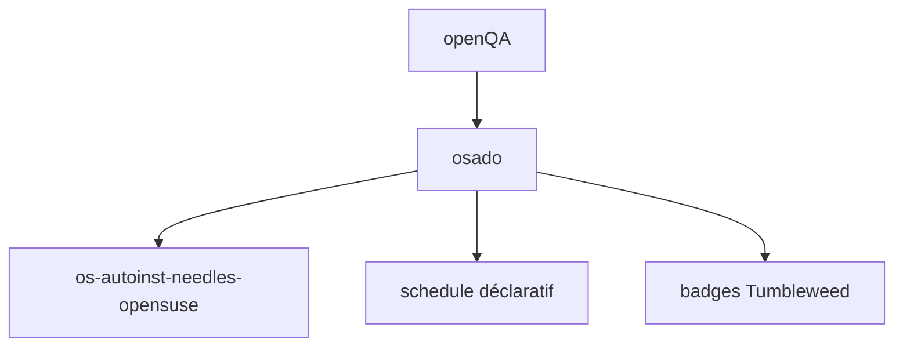

# os-autoinst/os-autoinst-distri-opensuse

> openQA test suite for openSUSE and SUSE Linux Enterprise, for quality assurance teams.

## The problem
Validating a Linux distribution at every build requires automated installation and interface tests.

## What it actually does
Contains the test distribution and the harness run by openQA: installation, GNOME, KDE on Tumbleweed. The "needles" live in a separate repository. A declarative mechanism orders the modules. The README requires AI assistants to read AGENTS.md.

## How it is wired

## Trying it
No command documented in the README. See the contribution guide and open.qa.

## Cost and gotchas
Free, but requires an openQA instance. No license declared; 161 open issues.

## What it is not
Not a generic testing tool: specific to SUSE distributions.

## Alternatives
No alternative named in the README.

## For you
Ignore: tests for a Linux distribution, outside your scope.
