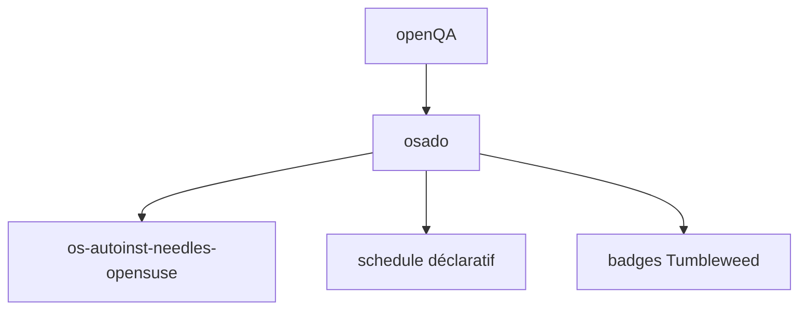

# os-autoinst/os-autoinst-distri-opensuse

> Suite de tests openQA pour openSUSE et SUSE Linux Enterprise, pour équipes d'assurance qualité.

## Le problème
Valider une distribution Linux à chaque build exige des tests d'installation et d'interface automatisés.

## Ce que ça fait vraiment
Contient la distribution de tests et le harnais exécutés par openQA : installation, GNOME, KDE sur Tumbleweed. Les « needles » vivent dans un dépôt séparé. Un mécanisme déclaratif ordonne les modules. Le README impose aux assistants IA de lire AGENTS.md.

## Comment c'est branché

## Essayer
Aucune commande documentée dans le README. Voir le guide de contribution et open.qa.

## Coût et pièges
Gratuit, mais requiert une instance openQA. Aucune licence déclarée ; 161 issues ouvertes.

## Ce que ce n'est pas
Pas un outil de test générique : propre aux distributions SUSE.

## Alternatives
Aucune alternative nommée dans le README.

## Pour toi
À ignorer : tests d'une distribution Linux, hors de ton périmètre.

