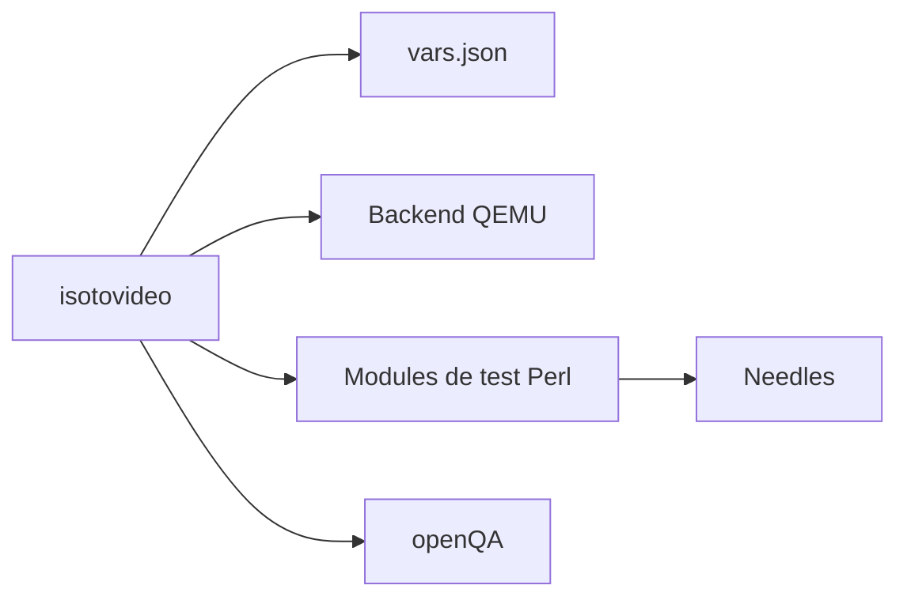

# os-autoinst/os-autoinst

> Automated operating system test engine, driven by QEMU, used with openQA.

## The problem
Testing installers, bootloaders and kernels is slow and does not fit classic test frameworks.

## What it actually does
`isotovideo` launches a virtual machine (QEMU by default) from an ISO, reads its parameters from `vars.json` or the command line, and runs test modules written in Perl (experimental Python support). Screen recognition relies on screenshots compared against "needles". A container image lets you use it in CI.

## How it is wired


## Trying it
```bash
podman run --rm -it -v .:/tests registry.opensuse.org/devel/openqa/containers/isotovideo:qemu-kvm casedir=/tests
isotovideo distri=opensuse casedir=/full/path/for/tests iso=/full/path/for/iso
make
```

## Cost and gotchas
Access to `/dev/kvm` is recommended, otherwise execution is slow. Tests require a test distribution and needles to be cloned separately. `vars.json` is modified by the tool: back up hand-written versions.

## What it is not
Not a web interface: that is openQA. Not a testing tool for ordinary applications.

## Alternatives
openQA (web interface to run several instances in parallel); cited as a complement, not as a competitor.

## For you
Watch: interesting for testing images or runtime environments, if you do low-level MLOps.
