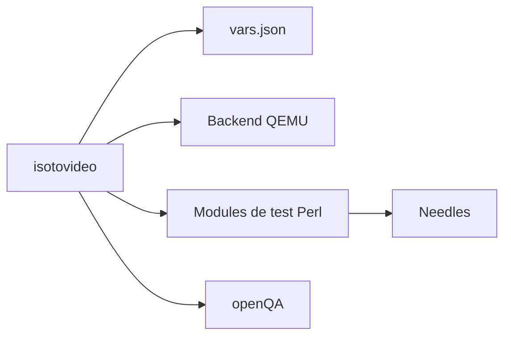

# os-autoinst/os-autoinst

> Moteur de tests automatisés de systèmes d'exploitation, piloté par QEMU, utilisé avec openQA.

## Le problème
Tester installeurs, chargeurs d'amorçage et noyaux est long et ne se prête pas aux frameworks de test classiques.

## Ce que ça fait vraiment
`isotovideo` lance une machine virtuelle (QEMU par défaut) à partir d'une ISO, lit ses paramètres dans `vars.json` ou en ligne de commande, et exécute des modules de test écrits en Perl (support Python expérimental). La reconnaissance d'écran repose sur des captures comparées à des « needles ». Une image de conteneur permet de l'utiliser en CI.

## Comment c'est branché


## Essayer
```bash
podman run --rm -it -v .:/tests registry.opensuse.org/devel/openqa/containers/isotovideo:qemu-kvm casedir=/tests
isotovideo distri=opensuse casedir=/full/path/for/tests iso=/full/path/for/iso
make
```

## Coût et pièges
Accès à `/dev/kvm` conseillé, sinon exécution lente. Les tests demandent une distribution de tests et des needles à cloner à part. `vars.json` est modifié par l'outil : sauvegarder les versions écrites à la main.

## Ce que ce n'est pas
Pas une interface web : c'est openQA. Pas un outil de test d'applications ordinaires.

## Alternatives
openQA (interface web pour lancer plusieurs instances en parallèle) ; cité comme complément, pas comme concurrent.

## Pour toi
À surveiller : intéressant pour tester des images ou des environnements d'exécution, si tu fais du MLOps bas niveau.

