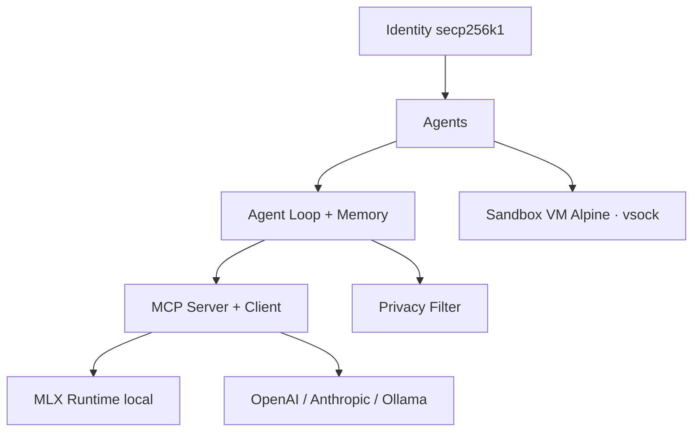

# osaurus-ai/osaurus

> Native macOS agent harness, written in Swift, that keeps memory, tools and identity on the machine.

## The problem
Assistants on the market host the layer that matters — context, memory, tools, identity — on their servers. You switch models easily, never memory providers.

## What it actually does
Each agent has its own prompts, its three-layer memory (identity, pinned facts, episodes) and its execution loop with a markdown task list. The sandbox is an Alpine Linux VM via Apple Containerization, linked over vsock. A local privacy filter detects and masks personal data before any cloud send, *fail-closed*. Full MCP server, and an MCP client to ~25 remote providers. OpenAI-, Anthropic- and Ollama-compatible endpoints.

## How it is wired


## Trying it
```bash
brew install --cask osaurus
osaurus ui
osaurus serve --port 1337
osaurus tools install osaurus.calendar
osaurus mcp
```

## Cost and gotchas
macOS 15.5+ and Apple Silicon required; the Linux VM needs macOS 26+, otherwise it falls back to a more limited Seatbelt sandbox. The privacy filter loads a ~2.8 GB model. Local storage is in clear by default (optional SQLCipher encryption). **Telemetry**: Aptabase analytics is opt-in, but Sentry crash reporting is opt-out, active by default.

## What it is not
Not cross-platform: Swift, Apple Silicon, nothing else. The built-in Orchestrator deliberately does no concrete work — no working folder, no sandbox, no browser. Osaurus Router, the hosted path, is pay-per-use.

## Alternatives
- **Ollama / LM Studio**: cited as providers; enough if you only want local inference.

## For you
Interesting if you are on a Mac and privacy comes first; otherwise it is a closed ecosystem.
