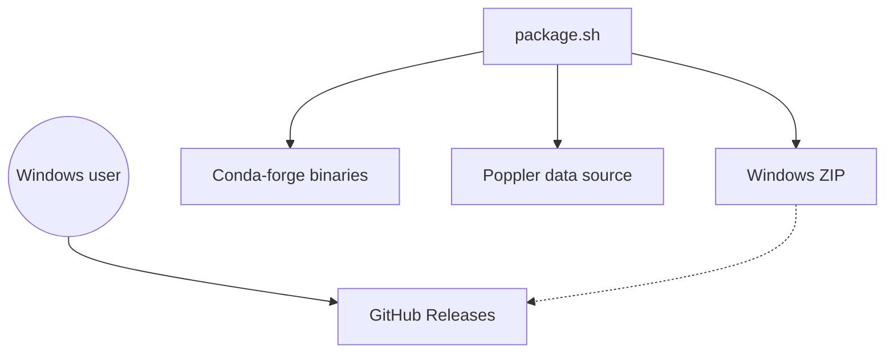

# oschwartz10612/poppler-windows

> ZIP archives of precompiled Poppler binaries for Windows, taken from conda-forge.

## The problem
Poppler (PDF tools) has no simple official Windows distribution; compiling it yourself is a pain.

## What it actually does
A package.sh script downloads the conda-forge binaries (poppler-feedstock) and the poppler-data data, then arranges them in a ZIP published in GitHub Releases. The repo does not compile Poppler. An update goes through changing `POPPLER_VERSION` or `POPPLER_DATA_URL` in package.sh.

## How it is wired

## Trying it
No command: download the ZIP from the repo's Releases page.

## Cost and gotchas
Free. Problems with Poppler itself go upstream (Poppler team or poppler-feedstock). You need to add the binaries folder to the PATH, which the README does not describe.

## What it is not
Not a fork nor a home-made build of Poppler: only a packaging of the conda-forge binaries.

## Alternatives
poppler-feedstock and conda-forge are cited as the upstream source.

## For you
Adopt if you extract text or images from PDFs on Windows: it is the simplest route to the Poppler binaries.
