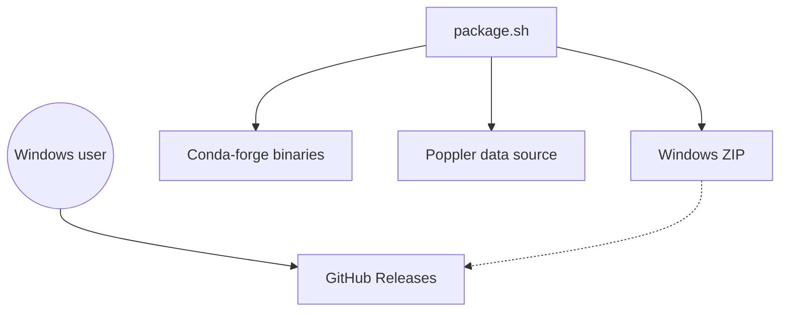

# oschwartz10612/poppler-windows

> Archives ZIP de binaires Poppler précompilés pour Windows, reprises de conda-forge.

## Le problème
Poppler (outils PDF) n'a pas de distribution Windows officielle simple ; le compiler soi-même est pénible.

## Ce que ça fait vraiment
Un script package.sh télécharge les binaires conda-forge (poppler-feedstock) et les données poppler-data, puis les range dans un ZIP publié en GitHub Releases. Le dépôt ne compile pas Poppler. Une mise à jour passe par la modification de `POPPLER_VERSION` ou `POPPLER_DATA_URL` dans package.sh.

## Comment c'est branché

## Essayer
Aucune commande : télécharger le ZIP depuis la page Releases du dépôt.

## Coût et pièges
Gratuit. Les problèmes de Poppler lui-même vont en amont (équipe Poppler ou poppler-feedstock). Il faut ajouter le dossier des binaires au PATH, ce que le README ne décrit pas.

## Ce que ce n'est pas
Pas un fork ni une compilation maison de Poppler : seulement un empaquetage des binaires conda-forge.

## Alternatives
poppler-feedstock et conda-forge sont cités comme source amont.

## Pour toi
À adopter si tu extrais du texte ou des images de PDF sous Windows : c'est la voie la plus simple vers les binaires Poppler.

